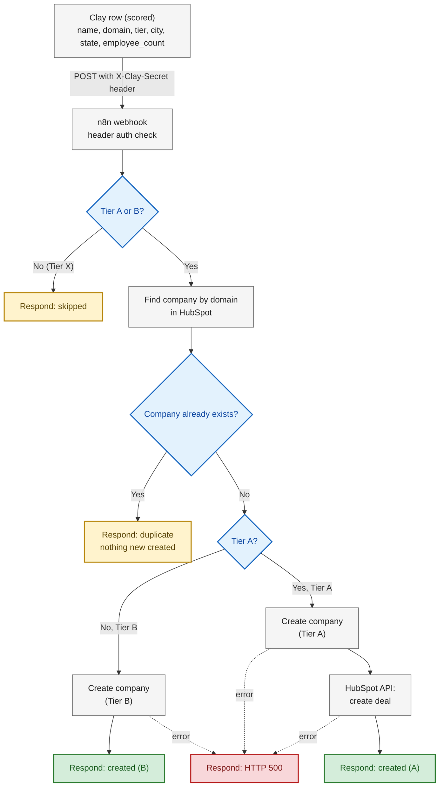

# Pump GTM: Fintech Account Scoring and Routing

A GTM pipeline that takes a Clay company export, scores accounts for fit with Pump's cloud-savings offer, and routes the top accounts to HubSpot through an n8n workflow.

## Case study

Full write-up on Notion: https://temporal-cartwheel-c34.notion.site/Case-Study-Scoring-Fintech-Accounts-for-Pump-s-Cloud-Savings-Outreach-422be9fece2880d7b3aad73ac307ad7b

## Workflow diagram

The diagram source is plain Mermaid text, so you can edit it directly here or paste it into the [Mermaid Live Editor](https://mermaid.live). A standalone copy is in `docs/workflow_diagram.mmd`.



## What is in this repo

| Path | What it is |
| --- | --- |
| `data/clay_export_raw.csv` | Clay export, 43 companies from a Find Companies table (Financial Services, 51-200 employees, US HQ) |
| `score_accounts.py` | Keyword-based fit scoring, tiering, and manual overrides |
| `output/scored_accounts.csv` | Scored output with tier, matched keywords, and override reasons |
| `n8n/clay_to_hubspot_workflow.json` | n8n workflow: Clay webhook, tier check, HubSpot company create |
| `docs/case_study.md` | Write-up of the approach, results, and next steps |

## Quick start

```bash
python3 score_accounts.py data/clay_export_raw.csv output/scored_accounts.csv
```

Requires Python 3.8 or later. No external packages.

## How scoring works

Each company description is scanned for keywords:

- **ICP signals** add points. Examples: payments, lending, embedded finance, checkout, receivables, B2B, fintech.
- **Out-of-ICP signals** subtract points. Examples: crypto or blockchain, insurance, wealth advisory, broker-dealers, trading platforms, banks, tax preparation, social networks.

Tiers:

| Tier | Score | Action |
| --- | --- | --- |
| A | 4 or higher | Route to AE now |
| B | 2 to 3 | Review by hand, then sequence |
| X | below 2 | Exclude |

Keyword scoring misses context. The `MANUAL_OVERRIDES` dict in `score_accounts.py` lets a reviewer set a tier and record why. Override reasons appear in the output file.

## Results on the current export

- 43 companies scored
- 5 Tier A, 6 Tier B, 32 excluded
- Most excluded companies are wealth advisors, broker-dealers, crypto firms, and insurers. This is a signal that the Clay criteria need tighter keyword filters, not just a size band.

## n8n workflow

1. Create a Clay table with a "Send to webhook" action (or HTTP API column) that posts each scored row to your n8n webhook at `/clay-scored-account`.
2. The request body should include: `name`, `domain`, `tier`, `city`, `state`, `employee_count`.
3. Import `n8n/clay_to_hubspot_workflow.json` into n8n.
4. Replace the HubSpot credential placeholder with your own credential.
5. Activate the workflow.

Send only Tier A and B rows from Clay. Tier X rows should not reach HubSpot.

## Known limits

- The export has no funding stage, revenue, or tech stack columns. Those filters were applied in the Clay UI and are not in the file, so this repo cannot verify them.
- Employee Count is blank for most rows.
- Payaza's domain is a Linktree page, not a company site. Replace it before enrichment.
- Banked was acquired by National Australia Bank. Confirm it still fits the target before outreach.
- Qapital is a consumer savings app, so it is a weak B2B fit even though it scores Tier B.

## Next steps

1. Add Series B and C funding, revenue, and tech stack columns in Clay, then re-run the scoring.
2. Add a contact step (CFO, VP Engineering, or Head of Infrastructure) for Tier A accounts.
3. Run the n8n workflow on 5 Tier A accounts first and check HubSpot before scaling.

## Manual send fallback (terminal)

Use this only when the Clay send fails. Clay's HTTP API column stopped delivering rows to n8n during the pilot, so accounts can be sent straight from a terminal. Once Clay sends reliably again, go back to Clay and delete this section.

### Before you send

1. Set the secret for your shell session. Do not write it to a file:

   ```bash
   export CLAY_SECRET="your-secret-here"
   ```

2. Check the account's tier. Only Tier A and B accounts should be sent. Tier X accounts return `skipped` and must not reach HubSpot.

### Request fields

The body matches the Clay payload.

| Field | Value |
| --- | --- |
| `name` | Company name |
| `domain` | The company's own domain. Do not use a link page such as Linktree. |
| `city`, `state` | Headquarters location |
| `employee_count` | Leave as `""` until a real source exists |
| `tier` | `A` or `B` |

### Send one account

```bash
curl -s -X POST "https://saee-works-2026.app.n8n.cloud/webhook/clay-scored-account" \
  -H "Content-Type: application/json" \
  -H "X-Clay-Secret: $CLAY_SECRET" \
  -d '{"name":"BillGO","domain":"billgo.com","city":"Fort Collins","state":"Colorado","employee_count":"","tier":"A"}'
```

### Reading the response

| Response | Meaning | What to do |
| --- | --- | --- |
| `{"status":"created","tier":"A","name":"BillGO"}` | New company was created in HubSpot | Log the send |
| `{"status":"duplicate",...}` | Company already exists, nothing new was created | Log the send. Do not resend. |
| `{"status":"skipped",...}` | Tier X account | Do not resend |
| HTTP 500 | The workflow failed | Check the n8n execution log before resending, so the same account is not created twice |

### Log every manual send

Record the date, account name, domain, tier, response status, and the person who sent it. This keeps manual sends auditable and makes it clear which accounts came in through Clay and which came in through this fallback.
